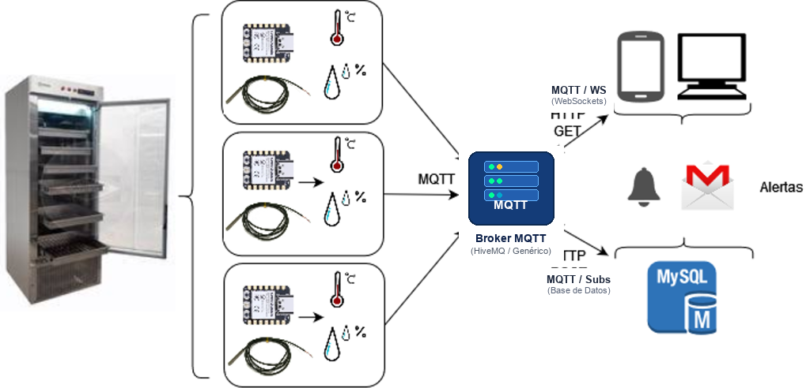

# 🚀 Bienvenida al Corte 3

## Agenda de la Sesión

1. **Evolución Tecnológica:** Del IoT al IoMT (1982 - 2026+).
2. **Anatomía de una "Cosa" en Salud:** Sensores, SoC, conectividad, actuadores y nube.
3. **Protocolo MQTT:** ¿Por qué no HTTP? Publish/Subscribe y QoS (0, 1, 2).
4. **Diseño Jerárquico de Tópicos:** Buenas prácticas hospitalarias.
5. **Caso Clínico:** Cadena de frío de fármacos en farmacia hospitalaria.
6. **Arquitectura del Sistema:** Sensores $\rightarrow$ Broker HiveMQ $\rightarrow$ Web/Alertas/DB.
7. **Taller Práctico:** XIAO ESP32-C3 + DHT22 en Wokwi y pruebas con HiveMQ WebSockets.

---

# 📜 Línea de Tiempo del IoT

## Hitos Históricos Clave

* **1982 - Máquina de Coca-Cola (Carnegie Mellon):**  
  Primer electrodoméstico en red; reportaba botellas disponibles y si estaban frías.
* **1990 - Internet Toaster (John Romkey):**  
  Primera tostadora encendida mediante comandos TCP/IP (SNMP).
* **1999 - Nacimiento del Término & Estándar:**  
  * Kevin Ashton (MIT Auto-ID) acuña *"Internet of Things"*.
  * Andy Stanford-Clark y Arlen Nipper crean **MQTT**.
* **2008 - Cruce de Población:**  
  Más dispositivos conectados a Internet que personas en el planeta.
* **2016 - Ataque Botnet Mirai:**  
  Millones de dispositivos IoT vulnerados alertan sobre ciberseguridad.
* **2024 - 2026+ - Era AIoT & IoMT:**  
  Inteligencia artificial en el microcontrolador (TinyML) y telemetría clínica masiva.

---

# 🏥 Del IoT al IoMT

## ¿Qué es el IoMT?

::: {.callout-note}
### Internet of Medical Things (IoMT)
Colección de dispositivos médicos, sensores fisiológicos y aplicaciones de software interconectados a la infraestructura informática de salud mediante redes telemáticas.
:::

* **Tolerancia Cero a Fallos:** Una alarma cardiaca o de cadena de frío no puede perderse.
* **Normativa Rigurosa:** FDA, Invima, ISO 13485 y privacidad de datos clínicos (Habeas Data / HIPAA).
* **Entornos Críticos:** Cuidados intensivos, salas de cirugía, transporte neonatal y bancos de vacunas.

---

## Industria 4.0 / 5.0 en Salud

Los cuatro pilares tecnológicos convergentes:

1. **Internet de las Cosas (IoT / IoMT):** Adquisición ubicua y continua.
2. **Sistemas Ciberfísicos (CPS):** Integración íntima entre hardware físico y algoritmos.
3. **Big Data:** Almacenamiento y procesamiento masivo de bioseñales.
4. **Inteligencia Computacional (IA / TinyML):** Diagnóstico predictivo y apoyo a decisiones clínicas.

---

# 📟 Anatomía de un Dispositivo IoMT

## Componentes Esenciales

* **1. Sensores (Captura):**  
  Transductores de magnitudes físicas o bioeléctricas (temperatura, humedad, PPG, ECG, presión).
* **2. Microcontrolador / SoC (Cálculo en el Borde):**  
  Ej. XIAO ESP32-C3, microprocesador con lógica de control (`if/else`), empaquetado y seguridad.
* **3. Conectividad (Transporte):**  
  Wi-Fi, Bluetooth Low Energy (BLE), LoRaWAN, Cellular NB-IoT.
* **4. Broker / Nube (Middleware):**  
  Gestor de colas y mensajería en tiempo real.
* **5. Actuadores & Alarmas:**  
  LEDs de alerta, relés, alarmas sonoras, notificaciones a personal médico.

---

# 📡 Protocolos de Comunicación

## HTTP vs. MQTT

| Parámetro | HTTP / REST | MQTT (Telemetría) |
| :--- | :--- | :--- |
| **Paradigma** | Request / Response (Síncrono) | Publish / Subscribe (Asíncrono) |
| **Cabecera** | Pesada (> 500 bytes - varios KB) | **Ultraligera (2 bytes)** |
| **Consumo Batería** | Alto (abre/cierra sockets TCP) | **Mínimo (socket persistente)** |
| **Flujo de Datos** | Sondeo (*Polling*) ineficiente | **Empuje (*Push*) instantáneo** |
| **Topología** | Punto a punto (conoce IP) | **Desacoplado por Broker** |

---

## El Desacoplamiento Tridimensional

MQTT desacopla completamente el emisor del receptor:

1. **Espacial:** El sensor no sabe quién consume el dato; solo conoce al Broker.
2. **Temporal:** Los dispositivos no necesitan estar conectados a la red al mismo instante (mensajes retenidos).
3. **De Sincronización:** El sensor publica de manera asíncrona y no se bloquea esperando confirmaciones pesadas.

---

## Calidades de Servicio (QoS)

* **QoS 0 — "At most once" (A lo sumo una vez):**  
  Fuego y olvido (*fire and forget*). Confía en TCP. Adecuado para lecturas frecuentes no críticas.
* **QoS 1 — "At least once" (Al menos una vez):**  
  Garantiza entrega mediante acuse de recibo (`PUBACK`). Puede haber duplicados en caídas de red.
* **QoS 2 — "Exactly once" (Exactamente una vez):**  
  Protocolo de 4 pasos (`PUBREC`, `PUBREL`, `PUBCOMP`). Garantía estricta de una sola entrega.  
  *Uso médico:* Dosificación de fármacos, alarmas de paro vital.

---

# 🗂️ Tópicos MQTT (Topics)

## Sintaxis Jerárquica

* Organizados en forma de árbol con diagonales: `/`.
* Son **sensibles a mayúsculas y minúsculas** (*case-sensitive*).
* **Comodines (Wildcards) para Suscripción:**
  * `+` : Reemplaza un único nivel.  
    *Ejemplo:* `hospital/farmacia/+/temperatura`
  * `#` : Multinivel (captura todo lo que cuelga por debajo).  
    *Ejemplo:* `hospital/farmacia/#`

---

# 💉 Caso Clínico Hospitalario

## Monitoreo de Cadena de Frío en Farmacia

* **Medicamentos Críticos:** Vacunas (COVID, influenza, rabia), medicamentos oncológicos biológicos e insulinas.
* **Ventana de Conservación Estricta:**
  $$\mathbf{2.0^\circ\text{C} \le \text{Temperatura} \le 8.0^\circ\text{C}}$$
* **Humedad Relativa:** 30% a 60% para evitar condensación y deterioro de empaques.
* **Consecuencias de Excursión Térmica:**
  * $> 8^\circ\text{C}$ (Calor): Desnaturalización proteica y pérdida de potencia inmunológica.
  * $< 2^\circ\text{C}$ (Congelamiento): Precipitación de sales adyuvantes de aluminio y daño tisular.

---

# 🏗️ Arquitectura de la Solución

## Diagrama del Sistema IoMT

{width="90%" fig-align="center"}

* **Origen:** Nevera con nodo XIAO ESP32-C3 + DHT22 y LED indicador.
* **Transporte:** Publicación MQTT hacia `broker.hivemq.com`.
* **Destinos:** WebSockets Dashboard (Web/Móvil), Control de Actuadores, Ingesta en BD.

---

# 🌐 El Broker HiveMQ

## Broker Público & Cliente WebSockets

* **Servidor Broker:** `broker.hivemq.com`
* **Puerto TCP (Hardware):** `1883`
* **Puerto WebSockets (Browser seguro):** `8884` (WSS, `/mqtt`)
* **Herramienta oficial en línea:** [https://www.hivemq.com/demos/websocket-client/](https://www.hivemq.com/demos/websocket-client/)

Permite probar de forma inmediata:
1. Suscripción a telemetría hospitalaria en tiempo real.
2. Publicación de órdenes remotas para encender/apagar el LED del microcontrolador.

---

# 🧪 Laboratorio Práctico en Wokwi

## Montaje con XIAO ESP32-C3

```text
       XIAO ESP32-C3               SENSOR DHT22
    +-----------------+         +-----------------+
    |            3V3  | ------> | VCC (Pin 1)     |
    |            GND  | ------> | GND (Pin 4)     |
    |             D2  | ------> | DATA (Pin 2)    |
    |             D4  | --[R]-> | LED ROJO ALERTA |
    +-----------------+         +-----------------+
```

* **Placa:** Seeed Studio XIAO ESP32-C3 en protoboard.
* **Pin D2:** Pin de datos del sensor DHT22.
* **Pin D4:** Salida digital gobernando el LED con resistencia de $1000\,\Omega$.
* **Bibliotecas:** `DHT sensor library` y `PubSubClient`.

---

## Formato de Telemetría JSON

### Publicación periódica cada 2 segundos
```json
{
  "temp": 4.50,
  "hum": 50.00,
  "alerta": false,
  "estado": "NORMAL"
}
```

* **Tópico de telemetría:**  
  `hospital/farmacia/nevera_01/telemetria` (y `TopicURSensorTempHum`)

* **ID Único Automático:**  
  Generado a partir de la MAC del ESP32 (`ESP32_XXXXXXXXXXXX`).

---

## Control Remoto Bidireccional (Actuador)

### Escucha mediante función `callback()`

```cpp
void callback(char* topic, byte* message, unsigned int length) {
  // Si llega "on" al tópico Led o hospital/farmacia/nevera_01/led
  if (messageTemp == "on") {
    digitalWrite(lamp, HIGH); // Enciende el LED en Wokwi
  } else if (messageTemp == "off") {
    digitalWrite(lamp, LOW);  // Apaga el LED en Wokwi
  }
}
```

Permite comandar desde cualquier parte del mundo el encendido o apagado de la alarma en la simulación.

---

## Pruebas con HiveMQ WebSocket Client

1. Conectar a `broker.hivemq.com` en puerto `8884`.
2. **Suscripción:** Agregar tópico `hospital/farmacia/nevera_01/telemetria`.  
   👉 Ver las lecturas de Wokwi llegando en vivo cada 2 s.
3. **Publicación:** Enviar al tópico `hospital/farmacia/nevera_01/led` (o `Led`):
   * Mensaje `"on"` $\rightarrow$ El LED en Wokwi se **enciende**.
   * Mensaje `"off"` $\rightarrow$ El LED en Wokwi se **apaga**.
4. **Simular Falla:** Deslizar la temperatura a $15^\circ\text{C}$ en Wokwi y verificar el reporte de `"alerta": true`.

---

# 🎯 Reto del Estudiante

## Entregables de la Sesión

1. **Circuito Funcional en Wokwi:** Montaje en protoboard con XIAO ESP32-C3, DHT22 y LED.
2. **Conexión MQTT Exitosa:** Telemetría en JSON transmitida hacia `broker.hivemq.com`.
3. **Control Bidireccional:** Demostrar encendido y apagado del LED desde el cliente web de HiveMQ.
4. **Simulación de Alarma:** Registro de excursión de temperatura fuera del rango $2^\circ\text{C}$ a $8^\circ\text{C}$.

---

# ❓ Preguntas & Discusión

## Contacto & Material del Curso

* **Docente:** Prof. Jefferson Sarmiento Rojas, Ph.D (c)
* **Correo:** [jefferson.sarmiento@urosario.edu.co](mailto:jefferson.sarmiento@urosario.edu.co)
* **Plataforma:** [https://urosario.edu.co/ifmer2026](https://urosario.edu.co/ifmer2026)
* **Universidad del Rosario** | Escuela de Medicina y Ciencias de la Salud
