# 🧠 Inteligencia en el Extremo Biomédico

## Agenda de la Sesión

1. **El Cambio de Paradigma:** De la programación tradicional a la computación neuronal.
2. **Evolución Histórica:** De la IA simbólica al Deep Learning a escala (1956 - 2026).
3. **Fundamentos Neuronales:** Suma ponderada (MACs), activación no lineal y memoria.
4. **Ciclo de Vida de Sistemas de ML:** Pipeline de 10 etapas y bucles de retroalimentación.
5. **Espectro de Inteligencia Distribuida:** Cloud ML vs. Edge ML vs. Mobile vs. TinyML.
6. **Reto Hospitalario:** Identificación visual de equipos biomédicos en rondas técnicas.
7. **Laboratorio XIAO ESP32S3 Sense:** Audio PDM/I2S, memoria OPI PSRAM y SenseCraft AI.

---

# 🔄 El Cambio de Paradigma

## Programación Clásica vs. Machine Learning

:::: {.columns}

::: {.column width="50%"}
### Programación Clásica (Deducción)
* El ingeniero programa **reglas** explícitas (`IF-THEN`).
* Procesa **datos** para obtener **respuestas**.
* Falla ante la variabilidad biológica y el ruido clínico.

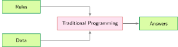{width="90%"}
:::

::: {.column width="50%"}
### Machine Learning (Inducción)
* Entregamos **datos** y **respuestas (etiquetas)**.
* El algoritmo aprende estadísticamente las **reglas (modelo)**.
* Generaliza patrones complejos en bioseñales e imágenes.

$$\text{Datos} + \text{Etiquetas} \rightarrow \text{Modelo}$$
:::

::::

---

# 📜 Olas de Evolución de la IA

## De Dartmouth al Edge AI

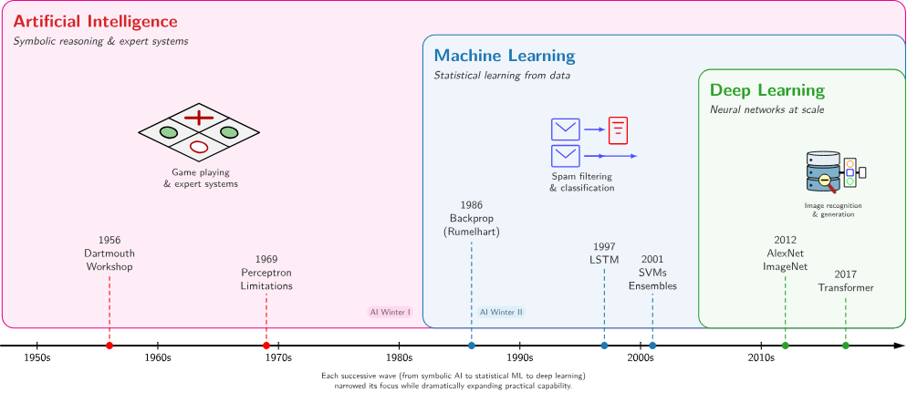{width="100%"}

* **1950s - 1970s (IA Simbólica):** Sistemas expertos y limitaciones del perceptrón.
* **1980s - 2000s (ML Estadístico):** Backprop, LSTMs, SVMs y cuello de botella de features manuales.
* **2010s - 2026+ (Deep Learning & TinyML):** Feature learning automático y modelos en MCUs.

---

# ⚡ Primitiva Computacional: La Neurona

## Suma Ponderada y Activación No Lineal

$$z = \sum_{i=1}^n w_i x_i + b = \mathbf{w}^T \mathbf{x} + b \quad \longrightarrow \quad a = \sigma(z)$$

:::: {.columns}

::: {.column width="50%"}
### Operación MAC (Multiply-Accumulate)
* Cada $w_i \cdot x_i + \text{acc}$ es 1 MAC (2 FLOPs).
* Determina el presupuesto de cómputo y consumo de batería en el microcontrolador.
:::

::: {.column width="50%"}
### Funciones de Activación
* **ReLU:** $\max(0, z)$ — Ultra eficiente en hardware embebido (un condicional `if`).
* **Sigmoide:** $\frac{1}{1 + e^{-z}}$ — Mapea a $[0, 1]$.
* **Softmax:** Capa final para clasificación multiclase.
:::

::::

---

# 🔄 Ciclo de Vida del Sistema de ML

## Pipeline de 10 Fases (MLSysBook / Reddi et al.)

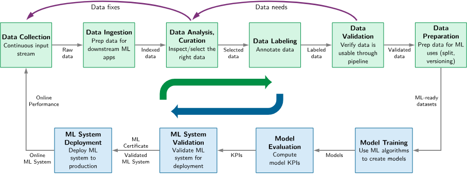{width="100%"}

* **Data-Centric AI:** Ingesta, curaduría, etiquetado y validación de calidad.
* **Model & Deployment:** Entrenamiento, evaluación con KPIs, cuantización y monitoreo online.
* **Feedback Loops:** *Data fixes* (corregir etiquetas) y *Data needs* (incorporar nuevos equipos).

---

# 🌐 Espectro de Inteligencia Distribuida

## ¿Dónde Debe Ejecutarse el Modelo?

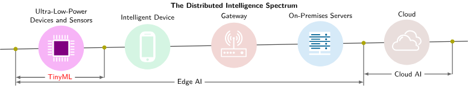{width="100%"}

* **Cloud ML:** Servidores en la nube (AWS/GCP), alta potencia (MW), alta latencia (100-500 ms).
* **Edge ML:** Servidores locales en hospital/UCI, latencia media (10-100 ms).
* **TinyML:** Microcontroladores en el sensor, latencia ultra baja (1-10 ms), consumo en miliwatts (mW).

---

# 📊 Comparativa de Paradigmas

## Latencia, Consumo, Memoria y Aplicaciones

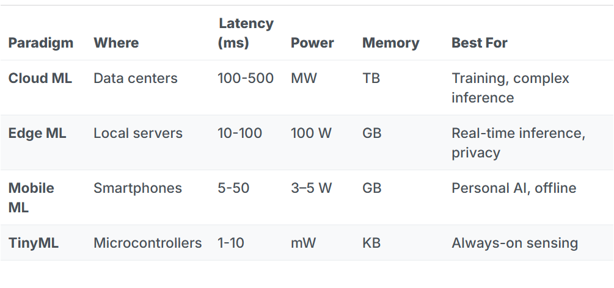{width="90%"}

* **¿Por qué TinyML en Salud?**
  1. **Privacidad (Habeas Data):** Las imágenes nunca viajan a internet.
  2. **Tiempo Real:** Detección en 1-10 ms sin depender de Wi-Fi o 4G.
  3. **Eficiencia Energética:** Computar localmente consume 1000x menos energía que transmitir por RF.

---

# 🏥 El Reto Clínico Hospitalario

## Rondas de Vigilancia e Inducción Técnica

* **Problema:** En servicios como UCI, Urgencias y Quirófano conviven decenas de bombas de infusión, monitores y desfibriladores de distintas marcas.
* **Riesgo:** Confusión en la operación, errores en bitácoras o demora en ubicar el manual técnico.
* **Solución de Ingeniería:**
  * Cámara embebida con TinyML para reconocer visualmente el equipo en tiempo real.
  * Publicación MQTT inmediata con el enlace URL al manual técnico del dispositivo.

---

# 🛠️ Plataforma: Seeed XIAO ESP32S3 Sense

## Especificaciones de Hardware

:::: {.columns}

::: {.column width="50%"}
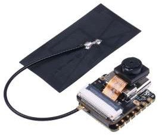{width="85%"}
:::

::: {.column width="50%"}
* **MCU:** ESP32-S3 Dual-Core Xtensa a 240 MHz con aceleración vectorial.
* **Visión:** Cámara desmontable **OV2640** (1600 × 1200 px).
* **Audio:** Micrófono digital PDM integrado (bus I2S).
* **Memoria:** 8 MB PSRAM (OPI) + 8 MB Flash + MicroSD (FAT32).
* **Conectividad:** Wi-Fi 2.4 GHz + BLE 5.0.
* **Tamaño:** 21 × 17.5 mm.
:::

::::

---

# 📌 Disposición de Pines (Pinout)

## Conexiones Clave en la XIAO ESP32S3

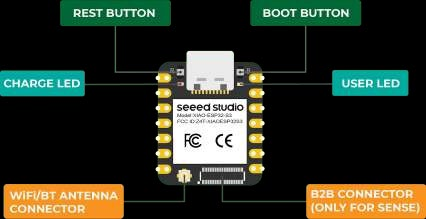{width="85%"}

* **LED de usuario:** GPIO 21
* **I2S Micrófono PDM:** GPIO 42 (Reloj PDM) / GPIO 41 (Datos PDM)
* **MicroSD CS:** GPIO 21 (compartido)

---

# 💻 Configuración en Arduino IDE

## Pasos 1 y 2: Placa y Blink

:::: {.columns}

::: {.column width="50%"}
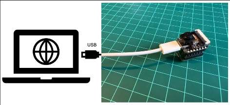{width="90%"}
* Instalar `esp32` by Espressif Systems.
:::

::: {.column width="50%"}
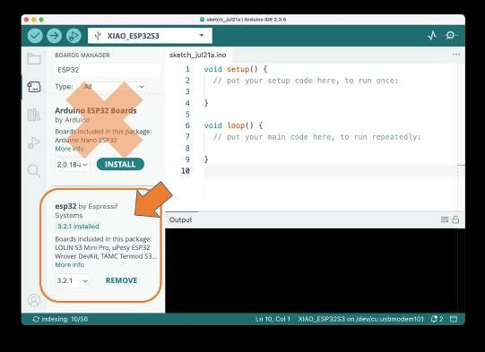{width="90%"}
* Seleccionar placa `XIAO_ESP32S3` y puerto COM.
:::

::::

* **Ejercicio 2:** Probar encendido/apagado del LED integrado en pin 21 con telemetría serial a 9600 bps.

---

# 🎙️ Adquisición de Audio Digital (I2S / PDM)

## Ejercicio 3: Lectura del Micrófono

```cpp
#include <ESP_I2S.h>
I2SClass I2S;

void setup() {
  Serial.begin(115200);
  I2S.setPinsPdmRx(42, 41); // PDM Clock = 42, PDM Data = 41
  I2S.begin(I2S_MODE_PDM_RX, 16000, I2S_DATA_BIT_WIDTH_16BIT, I2S_SLOT_MODE_MONO);
}

void loop() {
  int sample = I2S.read();
  if (sample != 0 && sample != -1 && sample != 1) {
    Serial.println(sample); // Visualizar en Serial Plotter
  }
}
```

---

# 💾 Memoria OPI PSRAM y Grabación WAV

## Ejercicio 4: Almacenamiento en MicroSD

:::: {.columns}

::: {.column width="45%"}
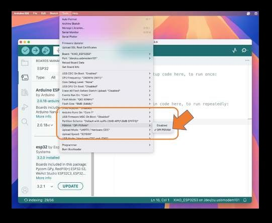{width="95%"}
* Habilitar `Tools -> PSRAM: "OPI PSRAM"` en Arduino IDE para disponer de 8 MB de RAM.
:::

::: {.column width="55%"}
* Graba 20 segundos de señal acústica en formato WAV a 16 kHz.
* Buffer alojado en PSRAM externa.
* Escritura directa en archivo `/audio_biomedico.wav` en la MicroSD formateada en FAT32.
:::

::::

---

# 🚀 Visión Artificial con SenseCraft AI

## Flujo de Trabajo sin Código

```
1. Conectar Navegador ──► 2. Test Cámara ──► 3. Dataset Equipos
         │                                         │
         ▼                                         ▼
6. Inferencia Local  ◄── 5. Desplegar Modelo ◄── 4. Entrenar
```

* Conexión por **Web Serial API** desde Google Chrome o Microsoft Edge.
* Acceso: [seeed-studio.github.io/SenseCraft-Web-Toolkit/](https://seeed-studio.github.io/SenseCraft-Web-Toolkit/)

---

# 📸 SenseCraft: Conexión y Cámara

## Pasos 1 y 2

:::: {.columns}

::: {.column width="50%"}
### Selección de Tarjeta
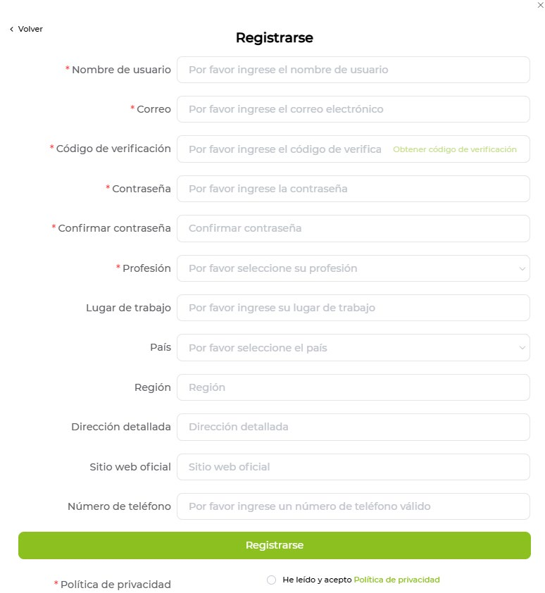{width="90%"}
Seleccionar `XIAO ESP32S3 Sense` y conectar puerto serie.
:::

::: {.column width="50%"}
### Prueba de Vídeo
{width="90%"}
Comprobar enfoque y tasa de cuadros del sensor OV2640.
:::

::::

---

# 🏷️ Creación de Dataset y Entrenamiento

## Pasos 3 y 4

:::: {.columns}

::: {.column width="50%"}
### Captura de Clases
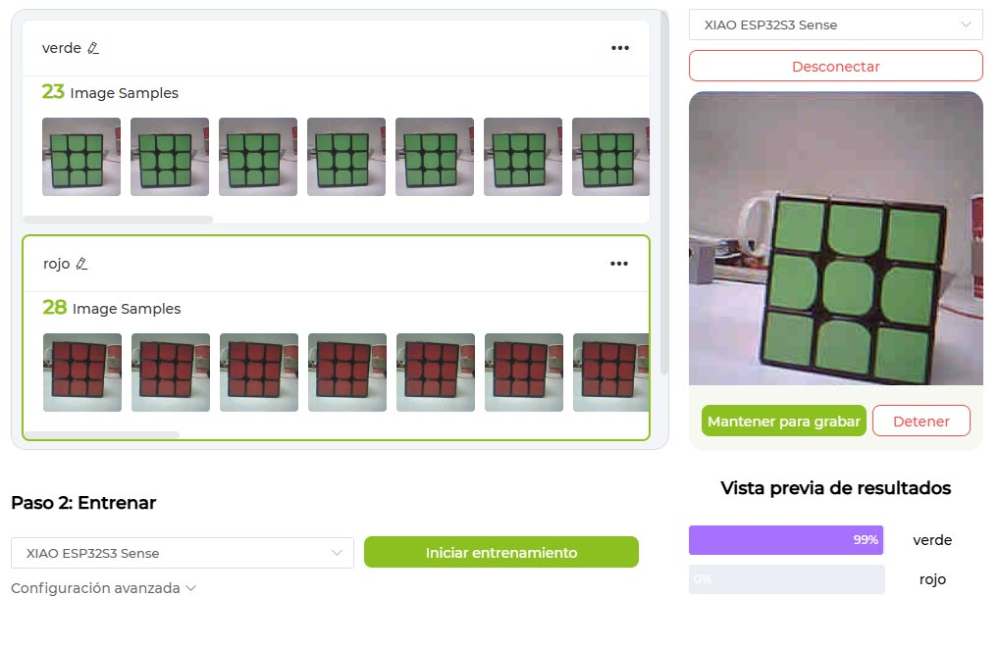{width="90%"}
* `Bomba_Infusion`
* `Monitor_Signos`
* `Desfibrilador`
:::

::: {.column width="50%"}
### Entrenamiento Embebido
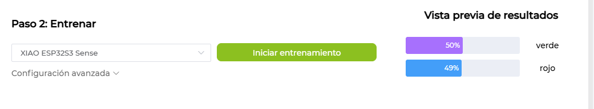{width="90%"}
* Red convolucional cuantizada en INT8 para TensorFlow Lite Micro.
:::

::::

---

# 🎯 Despliegue e Inferencia en Tiempo Real

## Pasos 5 y 6

:::: {.columns}

::: {.column width="50%"}
### Flasheo de Modelo
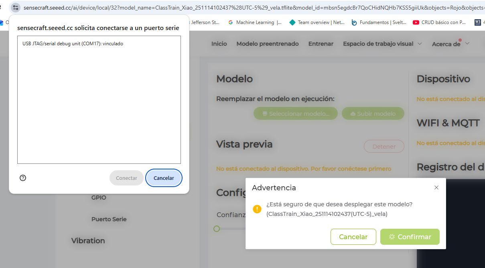{width="90%"}
Grabación directa en memoria Flash/PSRAM de la MCU.
:::

::: {.column width="50%"}
### Inferencia Local (15-30 FPS)
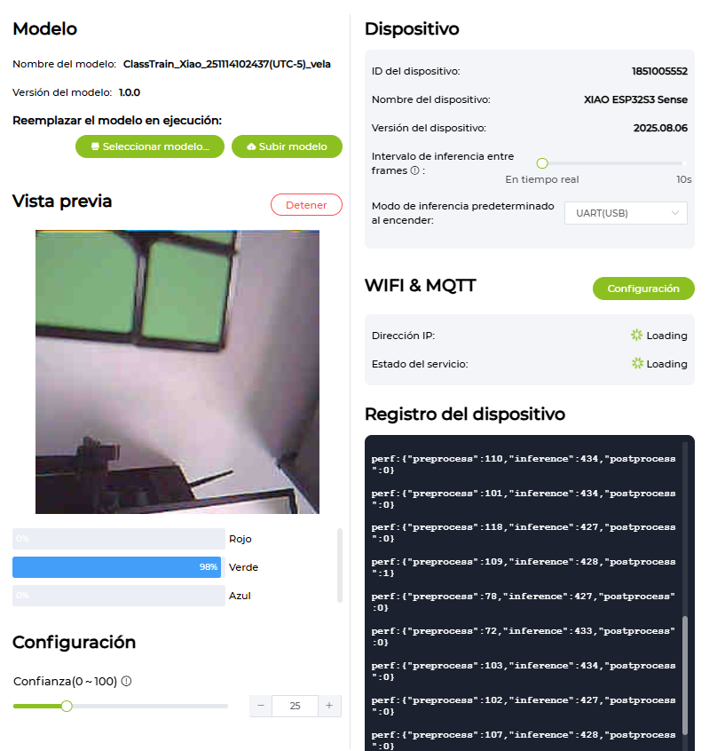{width="90%"}
Reconocimiento autónomo del equipo médico sin internet.
:::

::::

---

# 📡 Integración IoT: Despacho de Manuales vía MQTT

## Arquitectura de Solución Completa

```
[ Cámara XIAO ESP32S3 ]
         │ (Inferencia TinyML > 85%)
         ▼
[ Publicación MQTT JSON ]
         │ Tópico: hospital/piso3/uci/equipos/identificacion
         ▼
[ Broker HiveMQ ]
         │
         ▼
[ Tablet / Smartphone del Practicante ]
  ──► Enlace directo al Manual de Operación y Mantenimiento
```

---

# 📋 Criterios de Evaluación

## Entregables del Laboratorio

1. **Evidencia de Funcionamiento:**
   * Demostración en vivo o vídeo del clasificador TinyML reconociendo al menos **3 equipos biomédicos**.
2. **Registro de Telemetría:**
   * Captura del monitor serial o cliente MQTT mostrando la clase, certeza predictiva y URL del manual.
3. **Análisis Crítico:**
   * Reporte de latencia de inferencia (FPS), robustez ante cambios de iluminación y limitaciones del hardware.

---

# 📚 Referencias

* **Reddi, V. J., et al. (2024).** *Introduction to Machine Learning Systems: Neural Computation*. Harvard University / MLSysBook. [mlsysbook.ai](https://mlsysbook.ai/vol1/nn_computation/nn_computation.html)
* **Sarmiento Rojas, J. (2026).** *Guía de Laboratorio: Sistemas Inteligentes en Informática Médica*. Universidad del Rosario.
* **Warden, P., & Situnayake, D. (2019).** *TinyML: Machine Learning with TensorFlow Lite on Arduino*. O'Reilly.
* **Seeed Studio (2024).** *XIAO ESP32S3 Sense Documentation & SenseCraft AI Studio*.
